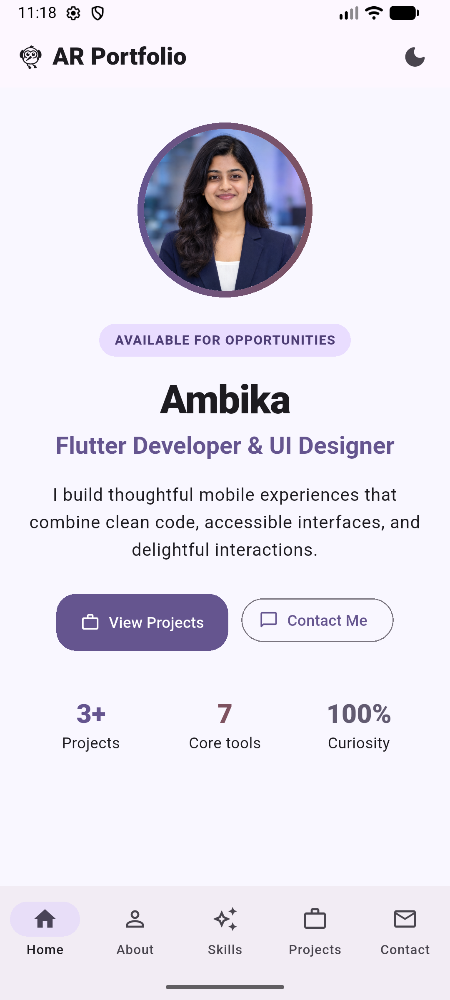
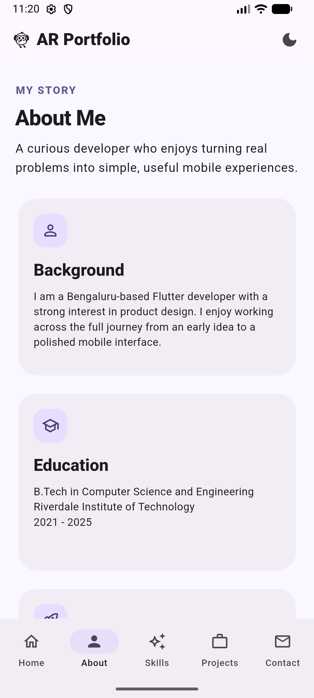
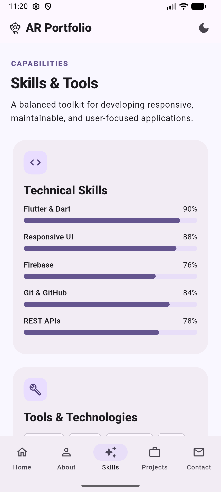
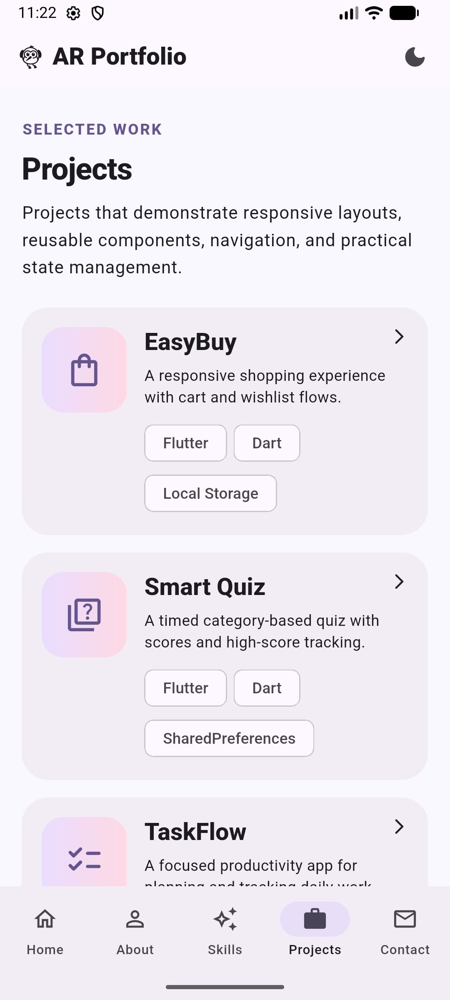
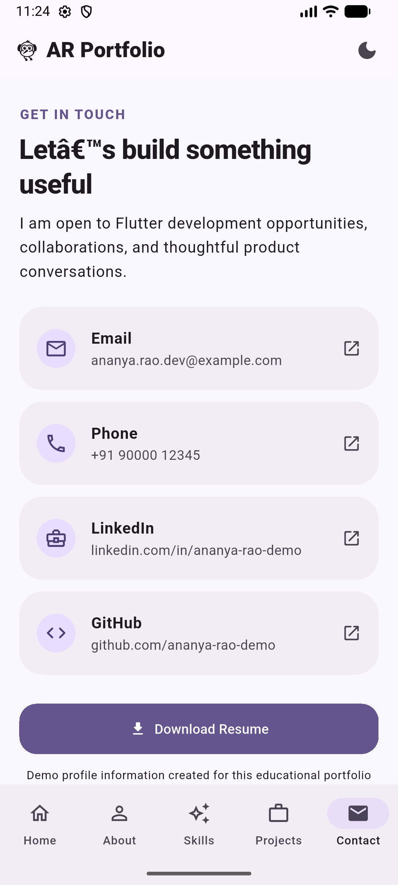

# Ananya Rao Portfolio

A responsive Flutter portfolio application created for the Week 02 Minor Project. The app uses a fictional demo identity and original generated profile image for educational presentation.

## Project Overview

The application presents a developer's profile, background, education, career objective, skills, projects, and contact information through a professional Material 3 interface.

## Features Implemented

- Home, About, Skills, Projects, and Contact screens
- Responsive mobile layouts
- Bottom navigation with animated screen transitions
- Persistent light and dark themes
- Animated skill indicators
- Reusable cards and section components
- Project detail screens with Hero transitions
- Working email, phone, LinkedIn, and GitHub launch actions
- Downloadable bundled PDF resume
- Original generated demo profile image

## Technologies Used

- Flutter
- Dart
- Material 3
- shared_preferences
- url_launcher
- path_provider

## Installation

1. Install Flutter and confirm it with `flutter doctor`.
2. Open a terminal in the project folder.
3. Run `flutter pub get`.
4. Run `flutter run`.

If the Android, iOS, web, Windows, Linux, or macOS platform folders are absent, run `flutter create .` once before `flutter pub get`.

## Validation

Run these commands before submission.

```bash
flutter analyze
flutter test
flutter build apk --debug
```
## Screenshots

| Home | About | Skills |
| --- | --- | --- |
|  |  |  |

| Projects | Contact |
| --- | --- |
|  |  |

## Demo Content Notice

Ananya Rao and all associated education and contact details are fictional. External profile links open the related service home pages for safe demonstration.
